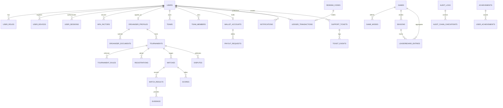

# Vexora Entity-Relationship Diagram (ERD) & Database Specification

This document provides the authoritative database design and relational model for the Vexora Esports Tournament Platform based on **Section 16 and Section 47** of the blueprint.

---

## 1. Schema Design Principles & Invariants

1. **Primary Keys**: All tables utilize **UUIDv7** (time-ordered sequential UUIDs) to preserve B-tree index locality while preventing enumeration attacks.
2. **Double-Entry Financial Accounting**:
   - `wallet_accounts` stores cached summary balances with `CHECK (available_balance >= 0)`.
   - `ledger_transactions` is strictly **append-only**.
   - Database triggers explicitly forbid `UPDATE` and `DELETE` on financial and audit tables.
   - For every reservation (`HOLD`), a corresponding entry is posted to the Escrow pool account.
3. **Idempotency**:
   - Mutation tables (`ledger_transactions`, `registrations`, `match_results`, `webhook_events`) enforce `UNIQUE(idempotency_key)` to eliminate duplicate actions.
4. **Time & Clocks**:
   - All timestamps are stored as `timestamptz` in **UTC**. Server clocks are strictly authoritative; client device clocks are ignored for tournament schedules and windows.
5. **Cryptographic Integrity**:
   - Every evidence row stores its SHA-256 ingress hash.
   - Every audit record links to its prior record's hash (`prev_hash`, `curr_hash`), forming a verifiable SHA-256 hash chain with daily Merkle root checkpoints.

---

## 2. Mermaid Entity-Relationship Diagram

---

## 3. Complete Table Catalog

### 3.1 Identity, Users & Roles
- **`users`**: Core user accounts. `id` (UUIDv7, PK), `username` (VARCHAR, UNIQUE), `phone` (VARCHAR, UNIQUE), `email` (VARCHAR, UNIQUE), `status` (VARCHAR), `created_at` (TIMESTAMPTZ), `last_login` (TIMESTAMPTZ).
- **`user_roles`**: RBAC role mappings. `user_id` (FK), `role_id` (FK), `assigned_by` (FK), `assigned_at` (TIMESTAMPTZ).
- **`user_devices`**: Device registry. `id` (UUIDv7, PK), `user_id` (FK), `device_fingerprint_hash` (VARCHAR), `platform` (VARCHAR), `push_token` (TEXT), `trust_level` (VARCHAR), `first_seen` (TIMESTAMPTZ), `last_seen` (TIMESTAMPTZ).
- **`user_sessions`**: Active login sessions. `id` (UUIDv7, PK), `user_id` (FK), `device_id` (FK), `refresh_token_hash` (VARCHAR), `expires_at` (TIMESTAMPTZ), `revoked_at` (TIMESTAMPTZ), `ip_hash` (VARCHAR).
- **`mfa_factors`**: Multi-factor credentials. `id` (UUIDv7, PK), `user_id` (FK), `type` (TOTP / WEBAUTHN / SMS), `secret_ref` (TEXT), `verified_at` (TIMESTAMPTZ).

### 3.2 Games & Rules Engine
- **`games`**: Supported titles. `id` (UUIDv7, PK), `slug` (VARCHAR, UNIQUE), `name` (VARCHAR), `icon_url` (TEXT), `status` (VARCHAR).
- **`game_modes`**: Mode configurations. `id` (UUIDv7, PK), `game_id` (FK), `mode` (BATTLE_ROYALE / CLASH / 1V1), `team_size` (INT), `rules_version` (VARCHAR).
- **`seasons`**: Competitive seasons. `id` (UUIDv7, PK), `game_id` (FK), `name` (VARCHAR), `start_at` (TIMESTAMPTZ), `end_at` (TIMESTAMPTZ), `status` (VARCHAR).
- **`leaderboard_entries`**: Cached and historical rankings. `season_id` (FK), `game_id` (FK), `participant_id` (VARCHAR), `points` (INT), `rank` (INT), `updated_at` (TIMESTAMPTZ).

### 3.3 Teams & Rosters
- **`teams`**: Competitive rosters. `id` (UUIDv7, PK), `name` (VARCHAR), `tag` (VARCHAR), `owner_id` (FK), `game_id` (FK), `status` (VARCHAR), `created_at` (TIMESTAMPTZ).
- **`team_members`**: Roster slots. `team_id` (FK), `user_id` (FK), `in_game_uid` (VARCHAR), `role` (CAPTAIN / MANAGER / PLAYER / SUB), `status` (ACTIVE / PENDING / LEFT), `joined_at` (TIMESTAMPTZ).

### 3.4 Organisers & Trust Layer
- **`organiser_profiles`**: Organiser credentials. `user_id` (FK, PK), `tier` (STARTER / VERIFIED / PARTNER), `verification_status` (PENDING / APPROVED / REJECTED / SUSPENDED), `tournaments_completed` (INT), `dispute_rate` (NUMERIC), `rating_average` (NUMERIC).
- **`organiser_documents`**: Verification files. `id` (UUIDv7, PK), `organiser_id` (FK), `doc_type` (IDENTITY / BUSINESS / BANK_PROOF), `secure_bucket_ref` (TEXT), `review_status` (VARCHAR).
- **`kyc_cases`**: Regulatory compliance files. `id` (UUIDv7, PK), `user_id` (FK), `provider_ref` (VARCHAR), `status` (VARCHAR), `reviewed_by` (FK), `reviewed_at` (TIMESTAMPTZ).

### 3.5 Tournaments & Brackets
- **`tournaments`**: Competition instances. `id` (UUIDv7, PK), `organiser_id` (FK), `game_id` (FK), `mode_id` (FK), `status` (11-state enum), `title` (VARCHAR), `registration_open_at` (TIMESTAMPTZ), `check_in_at` (TIMESTAMPTZ), `match_start_at` (TIMESTAMPTZ), `capacity` (INT), `registered_count` (INT), `prize_pool` (NUMERIC), `escrow_locked` (BOOLEAN).
- **`tournament_rules`**: Versioned regulations. `tournament_id` (FK), `version` (VARCHAR), `rules_json` (JSONB), `published_at` (TIMESTAMPTZ).
- **`registrations`**: Participant entry. `tournament_id` (FK), `team_id` (FK nullable), `user_id` (FK nullable), `status` (CONFIRMED / WAITLIST / CANCELLED / CHECKED_IN), `idempotency_key` (VARCHAR, UNIQUE), `created_at` (TIMESTAMPTZ).
- **`matches`**: Bracket and lobby nodes. `id` (UUIDv7, PK), `tournament_id` (FK), `round_number` (INT), `match_number` (INT), `room_code` (VARCHAR encrypted), `room_password` (VARCHAR encrypted), `status` (SCHEDULED / LOBBY_READY / LIVE / RESULT_SUBMITTED / CONFIRMED / DISPUTED / FINAL), `scheduled_at` (TIMESTAMPTZ).
- **`match_results`**: Submitted results. `id` (UUIDv7, PK), `match_id` (FK), `submitted_by` (FK), `raw_submission_json` (JSONB), `adjudicated_result_json` (JSONB), `evidence_hash` (CHAR(64)), `status` (SUBMITTED / CONFIRMED / CONFLICTED / OVERRIDDEN), `idempotency_key` (VARCHAR, UNIQUE).
- **`scores`**: Deterministic scoring rows. `match_id` (FK), `participant_id` (VARCHAR), `kills` (INT), `placement` (INT), `bonus_points` (INT), `total_points` (INT), `formula_version` (VARCHAR).

### 3.6 Financial Ledger & Wallet
- **`wallet_accounts`**: Balances. `user_id` (FK, PK), `currency` (VARCHAR DEFAULT 'VEX_CREDIT'), `available_balance` (NUMERIC(14,2) DEFAULT 0.00), `held_balance` (NUMERIC(14,2) DEFAULT 0.00), `CONSTRAINT chk_avail_bal_non_neg CHECK (available_balance >= 0)`.
- **`ledger_transactions`**: Double-entry journal. `id` (UUIDv7, PK), `user_id` (FK), `account_id` (UUIDv7), `type` (CREDIT / HOLD / RELEASE / REFUND / REWARD / DEBIT_SETTLEMENT / ADJUSTMENT), `amount` (NUMERIC(14,2)), `reference_type` (TOURNAMENT / REDEEM / PAYOUT), `reference_id` (VARCHAR), `idempotency_key` (VARCHAR, UNIQUE), `created_at` (TIMESTAMPTZ).
- **`redeem_codes`**: Internal credit vouchers. `id` (UUIDv7, PK), `code_hash` (CHAR(64) UNIQUE), `batch_id` (UUIDv7), `credit_value` (NUMERIC(10,2)), `checksum_char` (CHAR(1)), `status` (ACTIVE / REDEEMED / EXPIRED / CANCELLED), `expires_at` (TIMESTAMPTZ), `redeemed_by` (FK nullable), `redeemed_at` (TIMESTAMPTZ).
- **`payout_requests`**: Cashout queue. `id` (UUIDv7, PK), `user_id` (FK), `amount` (NUMERIC(14,2)), `payment_method` (UPI / NEFT), `payment_ref` (VARCHAR), `status` (REQUESTED / UNDER_REVIEW / APPROVED / PROCESSING / PAID / REJECTED), `maker_id` (FK), `checker_id` (FK), `requested_at` (TIMESTAMPTZ), `reviewed_at` (TIMESTAMPTZ).

### 3.7 Disputes, Trust & Auditing
- **`reports`**: Infraction reports. `id` (UUIDv7, PK), `reporter_id` (FK), `target_type` (USER / TEAM / TOURNAMENT / MATCH), `target_id` (VARCHAR), `category` (CHEAT / HARASSMENT / NO_SHOW / FRAUD), `status` (SUBMITTED / INVESTIGATING / ACTIONED / DISMISSED).
- **`disputes`**: Official match protests. `id` (UUIDv7, PK), `tournament_id` (FK), `match_id` (FK), `opened_by` (FK), `reason` (TEXT), `status` (OPEN / EVIDENCE_REVIEW / MODERATOR_RESOLVED / APPEALED / FINAL), `decision` (VARCHAR), `resolved_by` (FK), `appeal_due_at` (TIMESTAMPTZ).
- **`evidence`**: Uploaded screenshots and recordings. `id` (UUIDv7, PK), `case_id` (VARCHAR), `uploaded_by` (FK), `object_storage_ref` (TEXT), `file_hash` (CHAR(64)), `antivirus_scan_clean` (BOOLEAN), `created_at` (TIMESTAMPTZ).
- **`notifications`**: User alerts and notifications. `id` (UUIDv7, PK), `user_id` (FK), `type` (VARCHAR), `payload` (JSONB), `read_at` (TIMESTAMPTZ), `created_at` (TIMESTAMPTZ).
- **`audit_logs`**: Cryptographic audit records. `id` (UUIDv7, PK), `actor_id` (FK), `action` (VARCHAR), `entity_table` (VARCHAR), `entity_id` (VARCHAR), `before_state` (JSONB), `after_state` (JSONB), `ip_hash` (VARCHAR), `prev_hash` (CHAR(64)), `curr_hash` (CHAR(64)), `timestamp` (TIMESTAMPTZ).
- **`audit_chain_checkpoints`**: Daily Merkle root checkpoints. `id` (UUIDv7, PK), `from_log_id` (UUIDv7), `to_log_id` (UUIDv7), `merkle_root` (CHAR(64)), `signature` (TEXT), `signed_at` (TIMESTAMPTZ).

### 3.8 Support, Gamification & Risk
- **`support_tickets`**: Customer support tickets. `id` (UUIDv7, PK), `user_id` (FK), `category` (VARCHAR), `priority` (LOW / MED / HIGH / CRITICAL), `status` (OPEN / PENDING_USER / RESOLVED / CLOSED), `sla_due_at` (TIMESTAMPTZ), `owner_id` (FK nullable).
- **`ticket_events`**: Audit trail for tickets. `id` (UUIDv7, PK), `ticket_id` (FK), `actor_id` (FK), `event_type` (REPLY / STATUS_CHANGE / ESCALATION), `payload` (JSONB), `created_at` (TIMESTAMPTZ).
- **`achievements`**: Badges. `id` (UUIDv7, PK), `badge_key` (VARCHAR, UNIQUE), `title` (VARCHAR), `description` (TEXT), `icon_ref` (TEXT).
- **`user_achievements`**: Awarded badges. `id` (UUIDv7, PK), `user_id` (FK), `badge_id` (FK), `awarded_at` (TIMESTAMPTZ), `source_ref` (VARCHAR).
- **`webhook_events`**: Idempotent provider webhooks. `id` (UUIDv7, PK), `provider` (RAZORPAY / CASHFREE / FIREBASE), `event_id` (VARCHAR, UNIQUE), `signature_ok` (BOOLEAN), `payload_hash` (CHAR(64)), `processed_at` (TIMESTAMPTZ).
- **`risk_events`**: Abuse anomaly logs. `id` (UUIDv7, PK), `user_id` (FK), `signal` (COLLUSION / SPEED_HACK / MULTI_ACCOUNT / RAPID_REGISTRATION), `score` (INT), `context_json` (JSONB), `created_at` (TIMESTAMPTZ).
- **`feature_flags`**: Dynamic system flags. `key` (VARCHAR, PK), `enabled` (BOOLEAN), `rollout_percent` (INT), `audience` (VARCHAR), `updated_by` (FK), `updated_at` (TIMESTAMPTZ).
